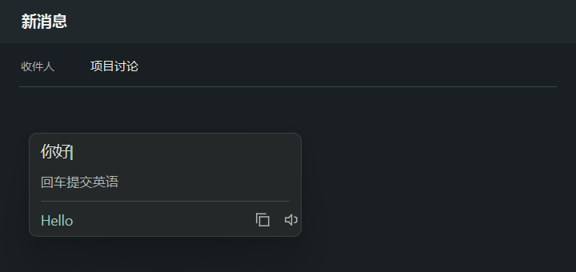

# Eternally

Windows 11 x64 翻译输入法。用熟悉的语言输入，在同一个候选窗里选词、预览译文，再按回车写入当前应用。

[使用说明](cmd/contextime/README.md) · [介绍页源码](docs/index.html) · [GitHub 项目](https://github.com/wiptgdxv/Eternally)



[拼音候选](docs/assets/ime-use-candidates.png) · [回车上屏](docs/assets/ime-use-committed.png) · [深色设置](docs/assets/windows-settings-dark.png)

## 可以做什么

- **选择翻译方向**：支持中文 → 日语、英文 → 中文等语言组合，设置中可以交换原文和目标语言。
- **一个候选窗**：原文、候选和译文一起显示。中文有待选拼音时，回车先选词；原文完成后，回车提交译文。
- **普通输入与翻译分开**：`Ctrl + F8` 切换模式。普通模式短按 `Shift` 在当前语言对之间切换；`Shift + 标点` 只输入标点。
- **中文里临时输入英文**：`shift` 可直接选英文原文，`nihao` 保留中文首选，`Windows` 保留大小写，支持空格和鼠标确认。
- **本地组字和学习**：中文全拼、简拼、混合拼音、词频排序、自定义短语；日语使用罗马字、假名和可用的 Windows 汉字候选。
- **标点跟随语言**：英文使用英文符号，中文使用中文标点，日语使用日语标点。网址和代码可原样输入。
- **可选离线中译英**：在设置中下载约 122 MB 模型；其他语言方向使用在线翻译。

## 从源码运行

当前仓库提交源码，公开安装包尚未发布。需要先在 Windows 11 x64 上构建，再运行安装脚本。

环境：Go 1.27.3、可编译 Windows x64 的 Zig、PowerShell。界面使用 MyGo v0.9.0，Go 后端不使用 cgo；系统输入法通过独立 TSF DLL 接入，无需小狼毫或 WebView2。

```powershell
git clone https://github.com/wiptgdxv/Eternally.git
cd Eternally
powershell.exe -NoProfile -ExecutionPolicy Bypass -File native-tsf/Build.ps1 -Zig 'C:\Tools\zig\zig.exe'
```

将最后一个参数替换为本机 Zig 路径。构建完成后，双击 `Install-ContextIME.cmd`，允许 Windows 安装授权，然后按 `Win + Space` 选择 Eternally。

`dist/ContextIME.exe` 直接启动为输入演示；系统输入法后台使用 `--native` 参数，安装脚本会负责启动。

## 构建与测试

```powershell
$env:CGO_ENABLED = '0'
go test ./... -count=1
powershell.exe -NoProfile -ExecutionPolicy Bypass -File native-tsf/Test-Shift.ps1 -Zig 'C:\Tools\zig\zig.exe'
```

介绍页位于 `docs/`，使用静态 HTML、CSS 和 JavaScript，无需打包。浏览器直接打开 `docs/index.html` 即可体验内置例句；网页演示不调用在线翻译接口。

## 项目结构

| 路径 | 内容 |
| --- | --- |
| `cmd/contextime/` | MyGo 候选窗、设置、输入状态、词库和学习逻辑 |
| `native-tsf/` | Windows TSF 接入、安装、构建和原生按键回归测试 |
| `internal/translation/` | 在线翻译、离线中译英和模型管理 |
| `docs/` | 暗色介绍页和交互演示 |
| `integration/`、`rime/`、根目录旧版 Go 入口 | 早期墨奇／小狼毫接入原型；当前安装使用独立 TSF 方案 |

旧版小狼毫流程保留在 [历史说明](integration/weasel/README.md)，不作为当前输入法的安装步骤。

## 数据与边界

在线翻译会将待译原文发送给微软 Edge 翻译服务。选词学习和自定义短语保存在本机 `%APPDATA%\ContextIME`，不随本仓库上传；会话译文缓存随后台退出清空。

离线模型仅支持中文 → 英语，只有用户启用在线回退时才会在模型不可用时使用在线服务。中文和日语已提供组合输入；其他复杂文字当前可通过粘贴原文进行翻译。

## 第三方许可与来源

依赖、字体和词库各自的许可见 [第三方说明](THIRD_PARTY_NOTICES.md)。拼音词库的 GPLv3 全文与来源说明随仓库保留；DM Sans 的 OFL 许可也随字体保留。

项目自有代码暂未另行指定开源许可证；第三方文件继续按各自许可证适用。视觉与交互参考 [Lo](https://github.com/chengpeng-cp/lo)，桌面界面由 [MyGo](https://github.com/egoist/mygo) 构建。
